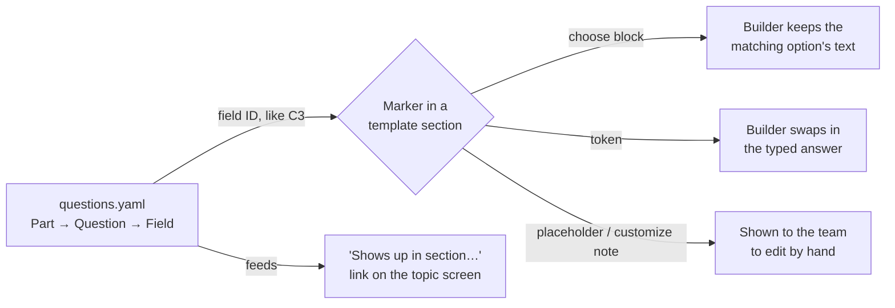

# Questionnaire → template map

This map shows how each questionnaire answer connects to the template sections. Use it to adapt the content, extend the questionnaire, or build your own tool on top of it.

Generated from `questionnaire/questions.yaml` and the `template/` files. Last updated 2026-11-20.

## How an answer reaches the guide

**The vocabulary**

- **Part** (A–E) → **question** (A1, C3) → **field** (C3, C3b). The field ID is the key everything matches on.
- **`feeds`**: the sections a question affects. It only powers the "Shows up in section 04" link. It doesn't change any text.
- **`recommended: true`**: the default answer, preselected in the builder.
- **`write_in: true`**: the option gets a text box. A `___` in the label does the same.

**The four kinds of marker in the template**

| Marker | Looks like | What happens |
|---|---|---|
| **Choose block** | `<!-- choose C3 -->` … `<!-- option "No, skip it" -->` … `<!-- option * -->` … `<!-- end choose -->` | The builder keeps only the text under the option whose label matches the answer (a partial match works: `"En dash"`). `option *` is the fallback when nothing else matches. |
| **Token** | `[Company]` (set by `token:` on a field) | Replaced everywhere with the typed answer. |
| **Placeholder** | `[guide owner, from A2]` | Left for the team to fill in. The "from A2" tells them which answer to use. |
| **Customize note** | `> **Customize (D5):** …` | An instruction to the team. It appears only when "Include customization notes" is on. |

**To trace a change:** find the field ID in the table below → open the listed section → search it for that ID.

**Rows marked "—"** have no marker in the template text. Those answers appear in the decisions summary rather than in the guide's wording.

## Part A · Setup

| Field | Question / prompt | Type | Shows up in |
|---|---|---|---|
| **A1** | Your team or company name | text | §06 (placeholder, customize note); §00 (token `[Company]`); §03 (token `[Company]`); §06 (token `[Company]`) |
| **A1b** | Common mistakes to avoid (for example, "Acme inc," "ACME," or "AcmeCo") | text | — (feeds: §03, §06) |
| **A2** | Style guide owner | text | §03 (placeholder); §04 (placeholder); §06 (placeholder); §12 (placeholder) |
| **A2b** | Best way to reach them (for example, email or a Slack channel) | text | — (feeds: §03, §12) |
| **A3** | Who decides, and by when | text | — (feeds: §12) |
| **A3b** | Final sign-off | text | — (feeds: §12) |
| **A3c** | Target date for the first version | date | — (feeds: §12) |
| **A4** | Where your docs live | multi | §05 (customize note) |
| **A4b** | Which one is the **source of truth** when docs disagree? | text | — (feeds: §04, §05) |
| **A5** | What this guide will cover | multi | §03 (customize note); §11 (placeholder) |
| **A6** | Doc types you write most | multi | §05 (customize note) |
| **A7** | Your top 3 doc pain points | multi | §01 (customize note); §02 (customize note) |
| **A8** | Now, later, or skip | nowlaterskip | §03 (customize note) |

## Part B · Audience & voice

| Field | Question / prompt | Type | Shows up in |
|---|---|---|---|
| **B1** | Who reads your docs | multi | §03 (customize note); §05 (customize note); §06 (customize note) |
| **B1b** | Do different readers use different parts of the docs? | single | — (feeds: §03, §06) |
| **B1c** | If yes, which readers use which docs? (For example, "Support uses the troubleshooting articles; new hires use onboarding.") | text | — (feeds: §03, §06) |
| **B1d** | How technical are most readers? | single · rec: A mix | — (feeds: §03, §06) |
| **B2** | Readers who speak English as a second language | single | §09 (customize note) |
| **B2b** | Do people use translation tools to read your docs? | single | — (feeds: §09) |
| **B3** | US or UK English | single | §06 (choose block, customize note) |
| **B4** | Overall tone | single · rec: Professional but friendly | §06 (customize note) |
| **B5** | How you talk to the reader | single · rec: "You" | §00 (customize note); §01 (choose block); §06 (choose block, customize note) |
| **B5b** | Use "we" for your team or company? | single · rec: Yes | §06 (choose block, customize note) |
| **B6** | Contractions | single · rec: Yes, use them (*don't*, *you'll*) | §06 (choose block, customize note) |
| **B7** | Emoji, GIFs, and humor | single · rec: Sparingly | §04 (choose block, customize note) |
| **B8** | Your reference style guide | single · rec: Microsoft Writing Style Guide | §06 (customize note); §13 (customize note) |
| **B8b** | For grammar and punctuation questions the main reference doesn't answer: | single · rec: The Chicago Manual of Style | — (feeds: §06, §13) |
| **B9** | Existing brand or voice guidelines | single | — (feeds: §03, §06) |

## Part C · Formatting

| Field | Question / prompt | Type | Shows up in |
|---|---|---|---|
| **C1** | Capitalization for titles and headings | single · rec: Sentence case: "How to reset your password" | §01 (choose block); §04 (choose block, customize note) |
| **C1b** | Headings inside a page: | single · rec: Sentence case | §04 (choose block) |
| **C2** | Lists | single · rec: Periods only when items are full sentences | §04 (choose block, customize note) |
| **C2b** | Start each item with a capital letter? | single · rec: Yes | §04 (choose block) |
| **C3** | The serial comma | single · rec: Yes, use it | §01 (choose block); §06 (choose block, customize note) |
| **C4** | Bold and italics | single · rec: Bold for UI labels and key warnings; italics for titles of other works | §04 (choose block, placeholder, customize note) |
| **C5** | Numbers | single · rec: Spell out zero through nine; use numerals for 10 and up | §01 (choose block); §06 (choose block, placeholder, customize note) |
| **C5b** | Ranges: | single · rec: En dash: "5–10" | §06 (choose block) |
| **C5c** | Units of measure your docs use often (for example, GB, MB, px, ft, kg): | text | — (feeds: §06) |
| **C6** | Dates, times, and time zones | single · rec: November 13, 2026 | §01 (choose block); §06 (choose block, customize note) |
| **C6b** | Times: | single · rec: 12-hour: 3:00 PM | §06 (choose block) |
| **C6c** | Time zones: | single · rec: Always include a time zone | §06 (choose block) |
| **C7** | UI elements, code, and keyboard keys | single · rec: **Bold**: Click **Save** | §01 (choose block); §04 (choose block, placeholder, customize note) |
| **C7b** | Keyboard shortcuts: | single · rec: Ctrl+C | §04 (choose block) |
| **C8** | Callouts: notes, tips, and warnings | multi | §04 (customize note) |
| **C8b** | Does your tool have built-in callout boxes (like Confluence panels or Notion callouts)? | single | — (feeds: §04) |
| **C9** | Links | single · rec: Fine, when the source is reputable (official vendor docs, standards bodies, or sources listed in §13) | §04 (choose block); §06 (choose block, customize note); §13 (placeholder) |
| **C9b** | Does your tool have a special link style (like Confluence smart links with the page icon and title)? | single | §04 (customize note) |
| **C10** | Images, screenshots, and video | multi · rec: Crop to the relevant area | §04 (placeholder, customize note) |
| **C10b** | Preferred file formats (for example, PNG for screenshots, GIF or MP4 for short demos): | text | — (feeds: §04, §07, §10) |
| **C11** | Color | single · rec: No, the tool's defaults are fine | §04 (placeholder, customize note) |
| **C12** | Citations and sources | single · rec: Link to the source inline | §06 (customize note); §13 (customize note) |

## Part D · Content policies

| Field | Question / prompt | Type | Shows up in |
|---|---|---|---|
| **D1** | Accessibility | single · rec: Follow the basics of WCAG 2.2 Level AA | §07 (customize note) |
| **D1b** | Do any of your readers use assistive technology (screen readers, screen magnifiers, voice control)? | single | — (feeds: §07) |
| **D1c** | How will you check docs for accessibility? Check all that apply: | multi | — (feeds: §07) |
| **D2** | Inclusive language | single · rec: No. Follow our main reference's guidance | §06 (customize note); §08 (customize note) |
| **D2b** | Terms your team has retired, and what to use instead (for example, whitelist → allowlist; master/slave → primary/replica): | text | — (feeds: §08) |
| **D3** | Sensitive information | multi | §10 (placeholder, customize note) |
| **D3b** | Where do secrets live instead (for example, your password manager)? | text | — (feeds: §10) |
| **D3c** | Who answers questions about where sensitive information should live (for example, customer addresses or phone numbers)? | text | — (feeds: §10) |
| **D3d** | Who should people contact if something sensitive gets posted by mistake? | text | — (feeds: §10) |
| **D4** | Legal and regulatory requirements | multi | §10 (placeholder, customize note) |
| **D4b** | Required labels or notices (for example, "Confidential: Internal use only"): | text | — (feeds: §03, §10) |
| **D5** | AI writing tools | single | §11 (placeholder, customize note); §13 (customize note) |
| **D5b** | Can writers use AI tools for docs? | single · rec: Yes, with human review | — (feeds: §11) |
| **D5c** | What can AI help with? Check all that apply: | multi | — (feeds: §11) |
| **D5d** | Should docs say when AI helped write them? | single · rec: Not required, as long as a person reviewed it | §11 (choose block) |

## Part E · Maintenance

| Field | Question / prompt | Type | Shows up in |
|---|---|---|---|
| **E1** | Who contributes to docs | single · rec: Anyone on the team, with review | §12 (customize note) |
| **E2** | How changes get approved | single · rec: Anyone can fix them right away | §12 (choose block, placeholder, customize note) |
| **E2b** | Bigger changes (new docs, rewrites, new rules for this guide): | single · rec: The doc owner or guide owner approves | — (feeds: §12) |
| **E2c** | What counts as a bigger change? (For example, anything that changes steps, a policy, or a rule in this guide.) | text | — (feeds: §12) |
| **E3** | How people suggest changes to this guide | multi | §12 (placeholder) |
| **E4** | Review schedule | single · rec: Every 6 months | §12 (customize note) |
| **E4b** | Show a "Last reviewed" date on docs? | single · rec: Yes | — (feeds: §12) |
| **E5** | Retiring old docs | single · rec: Archive it | §12 (placeholder, customize note) |
| **E5b** | Who decides? | text | — (feeds: §12) |
| **E6** | Sharing the guide | text | — (feeds: §03) |
| **E6b** | How will people find out about it? Check all that apply: | multi | — (feeds: §03) |
